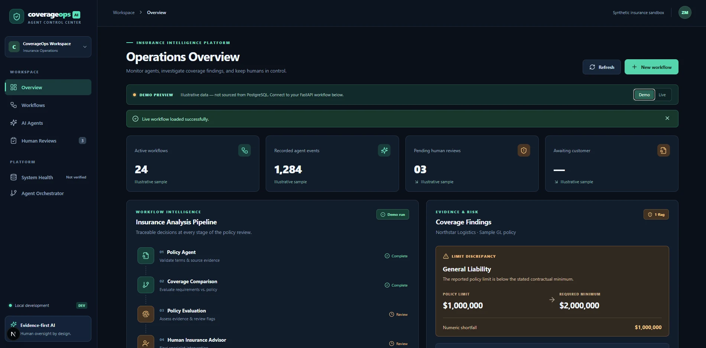
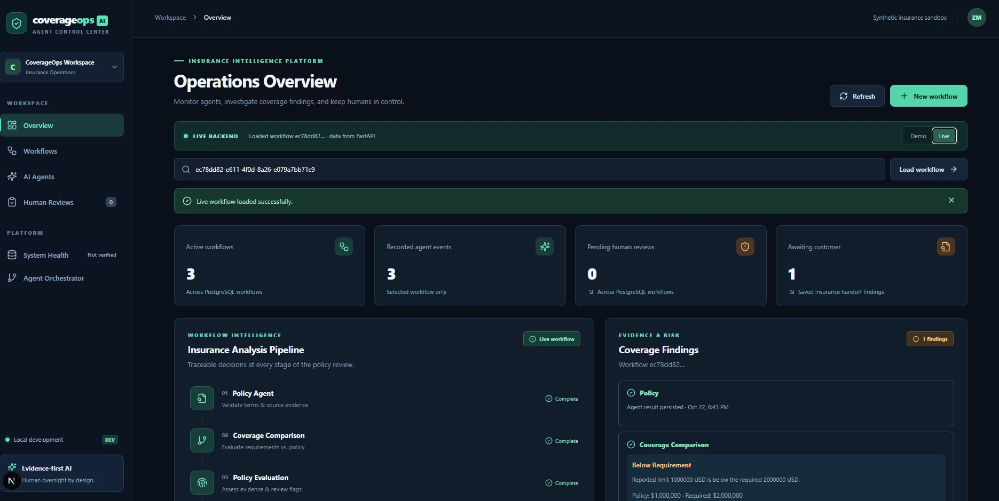
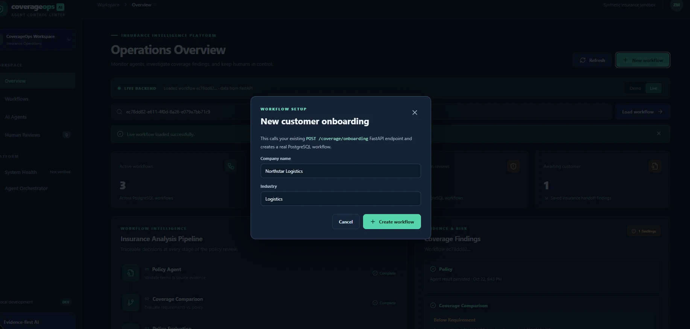
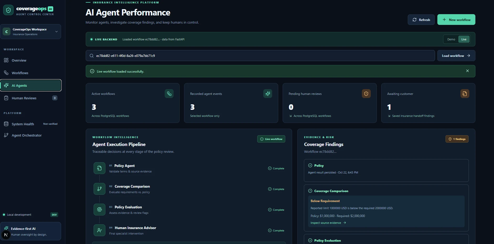

# CoverageOps AI

**Evidence-first insurance workflow intelligence · Multi-agent orchestration · Human-in-the-loop review**

CoverageOps AI is a full-stack engineering prototype for insurance operations. It evaluates structured policy information against contractual coverage requirements, identifies coverage gaps, tracks agent results, and supports human-review handoffs with persisted workflow events.

> **Project status:** Local development prototype using **synthetic insurance data**. The public GitHub repository contains source code, not a hosted service. The API is **not production-secure** and should not be exposed publicly without authentication, authorization, and deployment hardening.

## Product screenshots

### Operations overview — demo mode

Sample metrics and insurance examples are explicitly marked as illustrative. They are **not** retrieved from PostgreSQL.



### Operations overview — live backend

The dashboard loads a selected workflow through the Next.js API proxy and FastAPI. Live workflow metrics and stored results are backed by PostgreSQL.



### Customer onboarding

The new-workflow form uses the existing FastAPI onboarding endpoint to create a workflow record.



### AI agent performance

An execution pipeline shows policy analysis, coverage comparison, evaluation, and human review, alongside findings and evidence-related workflow records.



## What it demonstrates

- **Workflow orchestration:** Customer onboarding and persisted insurance workflow state.
- **Structured coverage comparison:** Numeric checks against contractual policy requirements.
- **Agent result visibility:** Recorded policy, comparison, and evaluation stages.
- **Human oversight:** Review requests and specialist decisions stored with workflow state.
- **Traceability:** Database-backed workflow events, findings, and review handoffs.
- **Live vs. demo transparency:** The UI explicitly distinguishes real backend responses from sample data.

## Example: Northstar Logistics (synthetic)

| General liability finding | Amount |
|---|---:|
| Reported policy limit | $1,000,000 |
| Required minimum | $2,000,000 |
| Calculated shortfall | **$1,000,000** |

The specialist requested changes, and the saved case progressed to **awaiting customer**. This is a demonstration of a structured coverage comparison, **not** a certified determination of insurance coverage.

## Architecture

```text
Next.js dashboard (React / TypeScript)
    |
    v
Next.js API proxy
    |
    v
FastAPI application
    |
    +-- Customer onboarding / workflow orchestration
    +-- Policy agent and policy validation
    +-- Coverage comparison
    +-- Policy evaluation
    +-- Human review handoff / recorded decision
    |
    v
SQLAlchemy + PostgreSQL
    +-- Workflows and events
    +-- Findings / agent results
    +-- Review records
```

## Stack

| Layer | Technology |
|---|---|
| UI | Next.js, React, TypeScript |
| API | Python, FastAPI |
| Data | PostgreSQL, SQLAlchemy, Alembic |
| Tests | Pytest |
| Local infrastructure | Docker Compose |
| Agent experimentation | Ollama integration in the broader codebase |

**Implementation note:** The presence of Ollama integration does not establish that every insurance result is produced by an LLM. Structured policy comparisons and agent stages should be evaluated on their actual implementation.

## Repository layout

```text
app/                     # FastAPI, workflow services, models, and agents
coverageops-dashboard/   # Next.js application and API proxy
alembic/                 # Schema migrations
tests/                   # Python test suite
docker-compose.yml       # Local supporting services
requirements.txt         # Python dependencies
```

## Local setup

### Backend

Use a compatible Python version, create a virtual environment, and install dependencies:

```powershell
python -m venv .venv
.\.venv\Scripts\Activate.ps1
python -m pip install -r requirements.txt
```

Configure the database using the project's local environment settings. Start PostgreSQL with the supplied Docker Compose configuration and apply the Alembic migrations after confirming the database connection string and target database. Do **not** run migrations against a database containing important information without checking the configuration.

Start FastAPI:

```powershell
python -m uvicorn app.main:app --host 127.0.0.1 --port 8002
```

- API documentation: `http://127.0.0.1:8002/docs`
- Health endpoint: `http://127.0.0.1:8002/health`

### Frontend

Open a second terminal:

```powershell
cd coverageops-dashboard
npm ci
npm run dev
```

The frontend is configured for `http://localhost:3001` in the current project. Its API proxy uses `BACKEND_URL` if configured, otherwise the local FastAPI URL `http://127.0.0.1:8002`. **Do not point the proxy to a publicly exposed, unauthenticated backend.**

### Verification

From the repository root:

```powershell
python -m pytest -q
```

From `coverageops-dashboard/`:

```powershell
npm run build
```

Latest verified local checkpoint: **54 Python tests passed** and the frontend production build completed. These checks do **not** constitute a security audit or end-to-end production certification.

## Security and limitations

- **Synthetic/demo data only.** Do not submit real policyholder data or credentials.
- **Not production-ready.** Authentication, role-based authorization, tenant isolation, and deployment security require further implementation and independent verification.
- **Human-in-the-loop does not imply access control.** Reviewer identity must be enforced server-side before real use.
- **No automated coverage certification.** Findings must be evaluated by qualified personnel with authoritative documentation.
- **Evidence limitations.** Structured inputs and recorded events do not automatically prove that a source insurance document is authentic.
- **Demo values are illustrative.** They should never be mistaken for organization-wide operational statistics.

## Roadmap

- Versioned policy correction and resubmission, preserving prior findings
- Reviewer case management and granular authorization
- Document ingestion with verifiable provenance
- More extensive validation, frontend tests, and end-to-end tests
- CI, monitoring, dependency scanning, and deployment hardening

---

**Built to explore practical, evidence-first AI systems and accountable enterprise workflows.**
